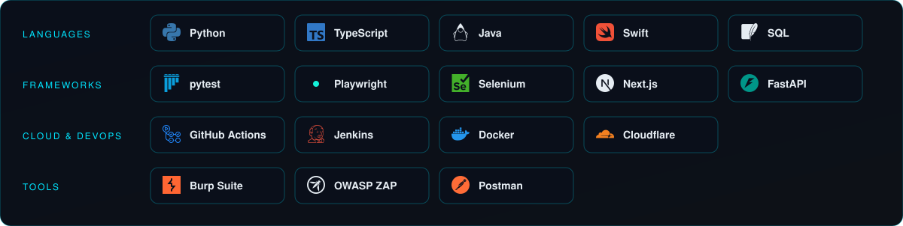
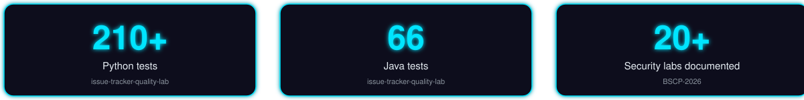
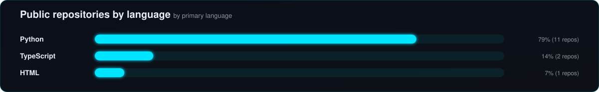
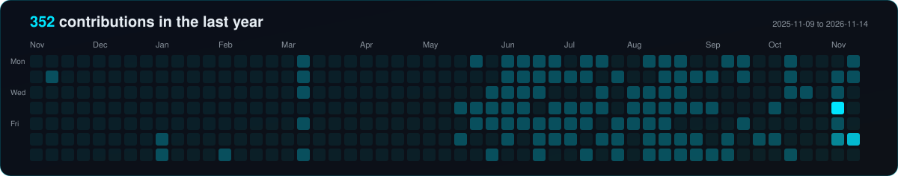

<h2 align="center">Hi, I'm Sandeep</h2>

  

## What I Do

- Design layered test strategies: unit, API, contract, SQL, event, UI, performance and security tests behind CI quality gates
- Build API security tooling that checks OWASP API Top 10 risks and reports in SARIF
- Use LLMs for test design and finding triage, with validation layers and human review
- Document web security labs in Burp Suite while preparing for the BSCP exam

## How I Test

## Tech Stack & Tools

## Featured Projects

<table>
<tr><td width="50%" valign="top"><b><a href="https://github.com/Naysrania18/insurance-quality-engineering">insurance-quality-engineering</a></b> Layered test strategy for a demo insurance platform, run behind CI quality gates. TypeScript, Playwright, Pact, k6, OWASP ZAP</td><td width="50%" valign="top"><b><a href="https://github.com/Naysrania18/issue-tracker-quality-lab">issue-tracker-quality-lab</a></b> Python, Java and Swift tests for a demo tracker, plus an MCP server and AI triage agent. Python, Java, Swift, pytest, TestNG</td></tr>
<tr><td width="50%" valign="top"><b><a href="https://github.com/Naysrania18/llm-vuln-triage">llm-vuln-triage</a></b> LLM triage of Semgrep and Bandit findings that checks each claim against the real code. Python, Semgrep, Bandit, SARIF</td><td width="50%" valign="top"><b><a href="https://github.com/Naysrania18/api-security-toolkit">api-security-toolkit</a></b> OpenAPI-driven OWASP API Top 10 checks with JSON, Markdown and SARIF reports. Python, OWASP API Top 10</td></tr>
</table>

## Achievements

- Enforced coverage gates (90% lines, 85% branches, 90% functions) on a demo insurance platform and documented four planted defects
- 210+ Python and 66 Java tests for a demo issue tracker, with an 85% coverage requirement in CI
- Evaluated an LLM triage pipeline on 22 labelled findings, reporting precision, recall and F1
- 22 tests covering an OpenAPI-driven security scanner against a deliberately vulnerable app

<!-- TODO(owner): add certifications, awards or work results with numbers (no LinkedIn data was available). -->

## Experience

<!-- TODO(owner): roles, companies and years from LinkedIn. No LinkedIn data was available; nothing is guessed here. -->
- **Education:** M.Sc. Cybersecurity, Atlantic Technological University, Ireland
- Roles and employers: see [LinkedIn](https://www.linkedin.com/in/sandeepnaysrania)

## Contribution Graph

## Connect

<!-- TODO(owner): add email and portfolio badges when you want them public. -->
