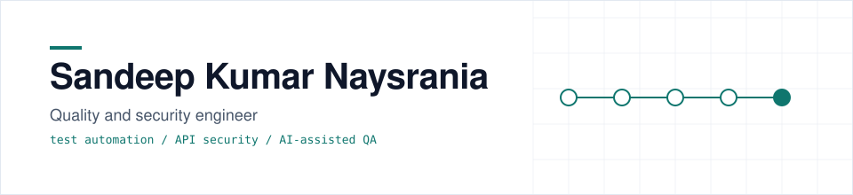
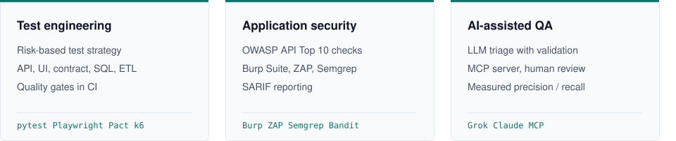

<picture>
  <source media="(prefers-color-scheme: dark)" srcset="assets/banner-dark.svg">
  
</picture>

**Quality and security engineer building test automation, API security tooling and AI-assisted QA.**

<!-- TODO(owner): add current role, employer and years of experience here as a 2-3 sentence summary. Not available from GitHub. -->
I design layered test strategies and security tooling for web and API systems: risk-based planning, automated suites in CI, and scanners that report in formats AppSec teams already use (SARIF). M.Sc. Cybersecurity, Atlantic Technological University, Ireland.

<picture>
  <source media="(prefers-color-scheme: dark)" srcset="assets/capabilities-dark.svg">
  
</picture>

## Currently

- Building quality-engineering reference projects with real CI quality gates
- API and web application security testing with Burp Suite and the OWASP methodology
- Using LLMs for test design and finding triage, with validation layers and human review

## Selected work

| Project | Outcome | Stack |
|---|---|---|
| [insurance-quality-engineering](https://github.com/Naysrania18/insurance-quality-engineering) | Layered test strategy for a demo commercial-insurance platform: unit, API, contract, SQL, event, migration, performance and security tests behind CI quality gates | TypeScript, Playwright, Pact, k6, OWASP ZAP |
| [issue-tracker-quality-lab](https://github.com/Naysrania18/issue-tracker-quality-lab) | 210+ Python tests and 66 Java tests against a demo tracker, plus an MCP server and a human-reviewed AI triage agent | Python, Java, Swift, pytest, TestNG, Jenkins |
| [llm-vuln-triage](https://github.com/Naysrania18/llm-vuln-triage) | Triages Semgrep and Bandit findings with an LLM and checks every claim against the real code to flag hallucinations; includes a precision and recall harness | Python, Semgrep, Bandit, SARIF |
| [api-security-toolkit](https://github.com/Naysrania18/api-security-toolkit) | Reads an OpenAPI spec and checks for BOLA, broken auth, data exposure and injection; JSON, Markdown and SARIF output | Python, OWASP API Top 10 |
| [SDET-framework](https://github.com/Naysrania18/SDET-framework) | One framework across API, UI, database and ETL tests with BDD and CI | Python, pytest, Playwright, GitHub Actions |

## Achievements

- Built a layered quality suite for a demo insurance platform with enforced coverage gates (90% lines, 85% branches, 90% functions) and four planted defects found and documented
- Wrote 210+ Python and 66 Java automated tests for a demo issue tracker, with an 85% coverage requirement in CI
- Designed an LLM triage pipeline that validates every model claim against the real code, evaluated on 22 labelled findings with precision, recall and F1 reported
- Shipped an OpenAPI-driven API security scanner with SARIF output, covered by 22 tests against a deliberately vulnerable app
- Documented 20+ solved web security labs while preparing for the Burp Suite Certified Practitioner exam
- Maintain public, CI-backed repositories with fake data only and explicit authorization guards on security tooling

<!-- TODO(owner): add real certifications, awards, bounty results or employer achievements with numbers. Not available from GitHub. -->

## Experience

<!-- TODO(owner): company, role, years from LinkedIn. Left out rather than guessed. -->
See [LinkedIn](https://www.linkedin.com/in/sandeepnaysrania).

## Stack

- **Languages:** Python, TypeScript, Java, Swift, SQL
- **Testing:** pytest, Playwright, Selenium, RestAssured, Pact, k6, Postman
- **Security:** Burp Suite, OWASP ZAP, Semgrep, Bandit, nuclei, ffuf
- **Infrastructure:** GitHub Actions, Jenkins, Docker

## Contact

[LinkedIn](https://www.linkedin.com/in/sandeepnaysrania)
<!-- TODO(owner): add email and portfolio link if you want them public. -->
